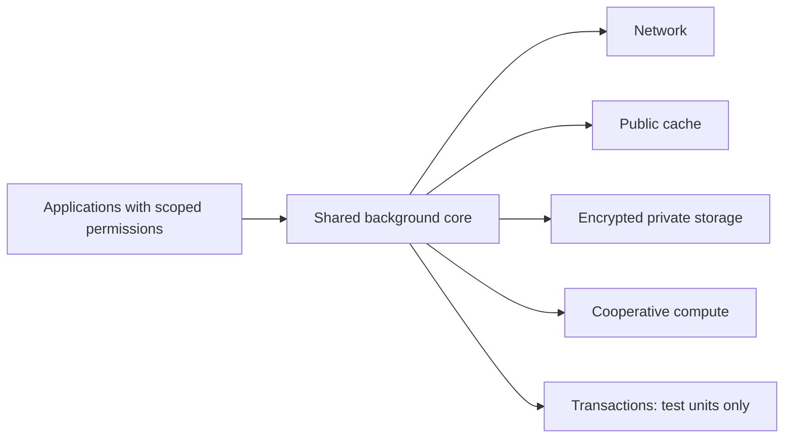

# Understand and evaluate VOLPAROSSA

VOLPAROSSA is building a **Decentralized Intelligent Cooperative Network (DICN)**:
a participant-operated foundation for protected connections, shared content,
private storage and cooperative AI. One reusable core connects those services to
applications. The initial core target is Debian 13 amd64.

**Development preview:** selected workflows have passed scoped trials, but there
is no supported end-user release. The [complete goal](../development/GOAL.md)
remains larger than the next milestone. Use the [current evidence ledger](../IMPLEMENTATION_STATUS.md)
for exact revisions and unfinished work.

## Why combine these services?

The aim is to make useful digital infrastructure available through cooperation,
including to people with modest devices. Participants contribute available
connectivity and resources, while their own foreground work takes priority.
Capacity, speed, energy use and model quality must be measured; more peers alone
do not establish an improvement or universal coverage.

| Familiar approach | VOLPAROSSA's intended distinction | What must still be demonstrated |
| --- | --- | --- |
| A conventional VPN service | Participant-operated relay and exit roles; each normal path separates the client-facing relay from the destination-facing exit. | Reliable expanded-alpha operation across the required devices and networks, beyond historical transport trials. |
| A distributed storage system | Private encrypted custody is one shared service, with a uniform redundancy policy and reciprocal capacity, alongside a separate public cache. | Joined Image/Cloud publication, maintenance, repeated restoration, deletion and confirmed provider cleanup. |
| A decentralized compute project | Core-owned task/resource coordination and shared models serve several applications; protected remote execution of private tasks is required. | Confidential peer admission and execution, reliable task outcomes and measured quality gains. |
| A centralized AI service | The intended resource pool is operated by participants, with explicit application permissions and inspectable open-source components. | Useful shared intelligence at practical cost and latency; no claim of competitive capability follows from a small model trial. |

These are architectural distinctions, not a performance ranking or a claim that
other projects lack these features. VOLPAROSSA does not invent connectivity,
eliminate hardware costs or make low-latency traffic untraceable.

## Follow a request through the architecture

This shows the intended service boundaries, not complete end-to-end acceptance.
Public caching, private files and message delivery have different authority and
retention rules. Private content is not automatically training data. Financial
participation is separate from contributing to the network.

Normal Internet paths are `client → exactly one relay → exit → destination`.
Parallel paths use different relays and the same exit. The relay knows the client
and selected exit; the exit knows the relay and destination. Client-to-exit
payload encryption remains intact across both WireGuard links. Exits enforce a
common threshold-signed destination policy; this is not an unrestricted proxy.
A global observer may still correlate both ends. See the
[architecture](../architecture/ARCHITECTURE.md) and [threat model](../privacy/THREAT_MODEL.md).

## Inspect three reproducible milestones

These original completed runs were rechecked on 20 October 2026. Their success
belongs to their recorded source and scope; it does not qualify a later build.
The linked owning guides explain fixtures and dependencies. Artifact retention
is finite: if a report has expired, record the gap rather than reconstructing a
successful outcome. Reviewing a run requires no local installation or network changes.

| Example | Exact source and evidence | Scope and limits |
| --- | --- | --- |
| Real transport acceptance | Core `482e33d0fda1d95fe0d3774c972cc0d424d0bb2a`; [A01–A15 run 34047766913](https://github.com/VOLPAROSSA/volparossa/actions/runs/34047766913); [test guide](../development/TESTING.md). | Disposable production-helper topology, actual transport paths and privacy/cleanup checks. Historical network checkpoint, not the entire DICN or current-main certification. |
| Installed Android Weather | Core `aac5be7f602fae9754153cdcb5c401ecb9ee7cb6`, Weather `3b90442a`; [run 38717988016](https://github.com/VOLPAROSSA/volparossa/actions/runs/38717988016); [Weather integration](https://github.com/VOLPAROSSA/volparossa-weather). | Real forecasts retrieved through protected peers into installed Overmorrow in an emulator, refresh and background/resume. Real-product expiry, physical phones and iOS remain open. |
| Model-driven coding | Code `fd4ff9688c58d6228e07f2116a7e8dcdb12a89ef`, core `7d0f9f0b`; [run 38824828727](https://github.com/VOLPAROSSA/volparossa-code/actions/runs/38824828727); [Code guide](https://github.com/VOLPAROSSA/volparossa-code). | Public fixture read/edit/test with independent verification, roughly 37 minutes. Local CPU model; not general coding reliability, competitive performance or private execution on a peer. |

To reproduce rather than inspect, use the exact owning repository's guide and
pinned dependencies. Begin with unprivileged source checks. Privileged/native/model
trials require the documented disposable environment and cleanup evidence; never
alter the active development host's network. There is no one-command end-user demo
that establishes all five layers and all applications.

## Find the next useful step

- **Developers and testers:** [contribute](../../CONTRIBUTING.md), then choose a bounded issue or reproduce one documented result.
- **Researchers:** inspect [privacy assumptions](../privacy/THREAT_MODEL.md), [shared compute](../services/DECENTRALIZED_AGENTS.md) or [storage](../services/PRIVATE_STORAGE.md); bring primary sources and explicit evaluation criteria.
- **Designers, writers and translators:** use the [shared contributor guide](https://github.com/VOLPAROSSA/.github/blob/main/CONTRIBUTING.md) and [accessibility guidance](https://github.com/VOLPAROSSA/.github/blob/main/ACCESSIBILITY.md).
- **Prospective supporters:** read [support and partnerships](SUPPORTING.md); payment participation is optional and funding cannot buy policy authority.
- **Anyone with a question:** use [central Discussions](https://github.com/VOLPAROSSA/volparossa/discussions). Keep actionable work in its owning repository and vulnerabilities private.

The next shared technical dependencies are private-storage maintenance and
protected peer computation. The [execution plan](../IMPLEMENTATION_STATUS.md#execution-priorities-and-next-milestones)
retains all application ambitions and unresolved acceptance failures.
